# Handwriting benchmark: evidence

Each case is written as **pen strokes** (handwriting font, per-character tilt/size/baseline jitter, thinned to a centre line, wobbled), turned into the picture the AI receives by the app's own `Board.snapshot()` in Chrome, then sent through the real `POST /api/ask` (login, safety rules, prompt, AI model).

* **Answer correct**: the answer contains the expected result (checked by a pattern, e.g. `x = 5`).
* **Read OK**: what the AI says it read is at least 72% similar to what was written.

Limits: the strokes are synthetic, so this measures reading messy, tilted, wobbly writing in two styles (print-like and cursive-like), not every real person's hand. Run it again with `python tools/handwriting_benchmark.py`.

## Summary

| Level | Answer correct | Read OK | Avg tokens | Avg seconds |
|---|---|---|---|---|
| small | **10/10** | 10/10 | 2217 | 3.8 |
| medium | **12/12** | 12/12 | 2249 | 3.9 |
| hard | **14/14** | 14/14 | 2320 | 4.3 |
| **all** | **36/36** | 36/36 | 2268 | 4.0 |

## Small

| Picture sent to the AI | Written | AI read | AI answer | Result |
|---|---|---|---|---|
|  **S1a** | 2 + 3 = ? | 2 + 3 = ? (conf 0.99) | 5 | ✅ 2190 tok, 3.6 s |
| 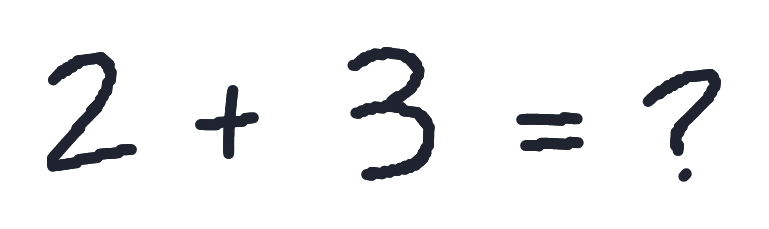 **S1b** | 2 + 3 = ? | 2 + 3 = ? (conf 0.99) | 5 | ✅ 2190 tok, 3.5 s |
| 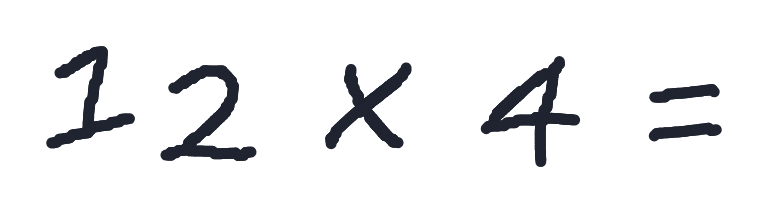 **S2a** | 12 x 4 = | 12 × 4 = (conf 0.99) | 48 | ✅ 2189 tok, 3.5 s |
| 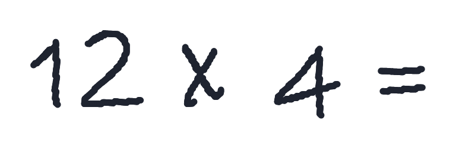 **S2b** | 12 x 4 = | 12 x 4 = (conf 0.99) | 48 | ✅ 2189 tok, 3.6 s |
| 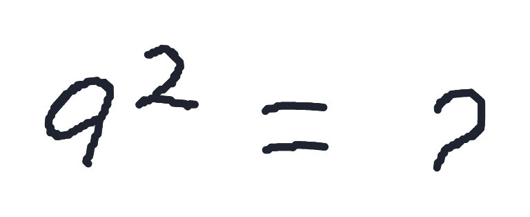 **S3a** | 9^2 = ? | 9² = ? (conf 0.98) | 81 | ✅ 2188 tok, 3.8 s |
| 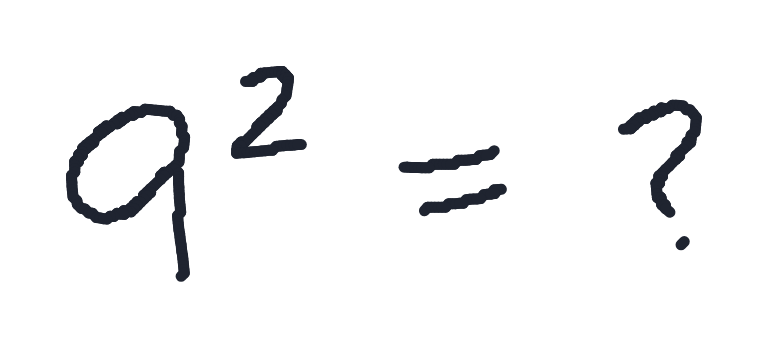 **S3b** | 9^2 = ? | 9² = ? (conf 0.98) | 81 | ✅ 2188 tok, 3.7 s |
|  **S4a** | photosynthesis | photosynthesis (conf 1) | Photosynthesis is the process by which green plants, algae, and some bacteria convert light energy, usually from the sun, into chemical energy in the form of glucose. Thi | ✅ 2320 tok, 4.7 s |
|  **S4b** | photosynthesis | photosynthesis (conf 1) | Photosynthesis is the process by which green plants, algae, and some bacteria convert light energy, usually from the sun, into chemical energy in the form of glucose. Thi | ✅ 2340 tok, 4.6 s |
| 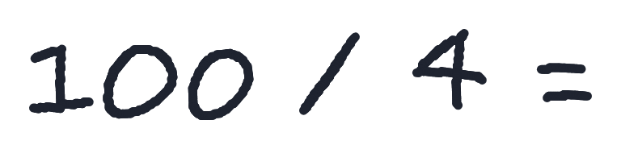 **S5a** | 100 / 4 = | 100 / 4 = (conf 0.99) | 25 | ✅ 2189 tok, 3.6 s |
| 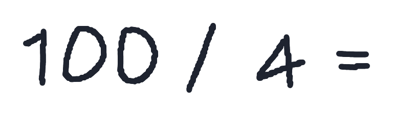 **S5b** | 100 / 4 = | 100 / 4 = (conf 0.99) | 25 | ✅ 2189 tok, 3.5 s |

## Medium

| Picture sent to the AI | Written | AI read | AI answer | Result |
|---|---|---|---|---|
| 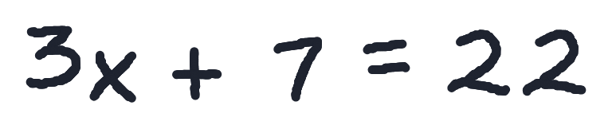 **M1a** | 3x + 7 = 22 | 3x + 7 = 22 (conf 0.99) | To solve for x, subtract 7 from both sides: 3x = 15. Then divide both sides by 3: x = 5. | ✅ 2223 tok, 3.7 s |
| 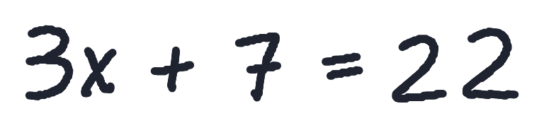 **M1b** | 3x + 7 = 22 | 3x + 7 = 22 (conf 0.99) | To solve for x, subtract 7 from both sides: 3x = 15. Then divide both sides by 3: x = 5. | ✅ 2223 tok, 3.8 s |
|  **M2a** | sin 30° = ? | sin 30° = ? (conf 0.99) | sin 30° = 0.5 | ✅ 2198 tok, 3.5 s |
| 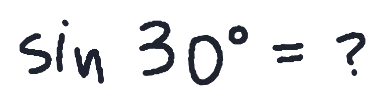 **M2b** | sin 30° = ? | sin 30° = ? (conf 0.99) | sin 30° = 0.5 | ✅ 2198 tok, 3.7 s |
| 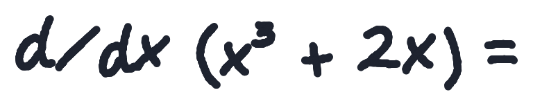 **M3a** | d/dx (x^3 + 2x) = | d/dx (x^3 + 2x) = (conf 0.98) | 3x² + 2 | ✅ 2202 tok, 3.6 s |
| 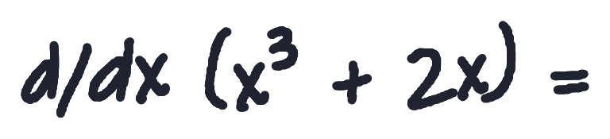 **M3b** | d/dx (x^3 + 2x) = | d/dx (x^3 + 2x) = (conf 0.98) | 3x² + 2 | ✅ 2202 tok, 3.5 s |
|  **M4a** | area of circle r = 7 | area of circle r = 7 (conf 0.99) | The area of a circle is calculated using the formula A = πr². For a circle with radius r = 7, the area is:  A = π × 7² = 49π ≈ 153.94 square units. | ✅ 2242 tok, 3.6 s |
| 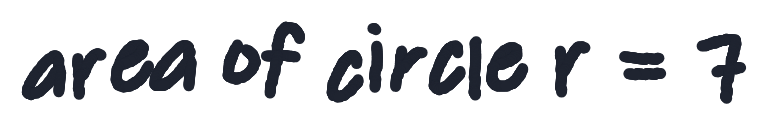 **M4b** | area of circle r = 7 | area of circle r = 7 (conf 0.98) | The area of a circle is calculated using the formula A = πr². For a circle with radius r = 7, the area is:  A = π × 7² = 49π ≈ 153.94 square units. | ✅ 2242 tok, 3.7 s |
|  **M5a** | binary search code | binary search code (conf 0.99) | Binary search is an efficient algorithm for finding an item from a sorted list of items. It works by repeatedly dividing the search interval in half. If the value of the  | ✅ 2393 tok, 4.9 s |
|  **M5b** | binary search code | binary search code (conf 0.99) | Binary search is an efficient algorithm for finding an item from a sorted list of items. It works by repeatedly dividing the search interval in half. If the value of the  | ✅ 2428 tok, 5.2 s |
| 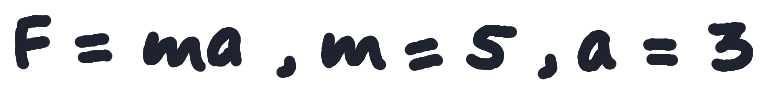 **M6a** | F = ma , m = 5 , a = 3 | F = ma, m = 5, a = 3 (conf 0.99) | F = ma = 5 × 3 = 15. The force F is 15 units. | ✅ 2217 tok, 3.5 s |
| 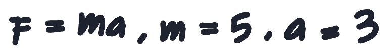 **M6b** | F = ma , m = 5 , a = 3 | F = ma, m = 5, a = 3 (conf 0.98) | F = ma = 5 × 3 = 15. The force F is 15. | ✅ 2216 tok, 3.6 s |

## Hard

| Picture sent to the AI | Written | AI read | AI answer | Result |
|---|---|---|---|---|
| 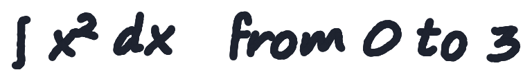 **H1a** | ∫ x^2 dx   from 0 to 3 | ∫ x² dx from 0 to 3 (conf 0.98) | To evaluate the integral ∫ x² dx from 0 to 3, find the antiderivative of x², which is (1/3)x³. Then, apply the limits of integration:  1. Calculate (1/3)x³ from 0 to 3. 2 | ✅ 2322 tok, 4.4 s |
| 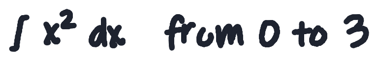 **H1b** | ∫ x^2 dx   from 0 to 3 | ∫ x² dx from 0 to 3 (conf 0.95) | To solve the integral ∫ x² dx from 0 to 3, find the antiderivative of x², which is (1/3)x³. Evaluate it from 0 to 3:  (1/3)(3)³ - (1/3)(0)³ = (1/3)(27) - 0 = 9.  So, the  | ✅ 2281 tok, 4.4 s |
|  **H2a** | x^2 - 5x + 6 = 0 | x² - 5x + 6 = 0 (conf 0.98) | To solve the quadratic equation x² - 5x + 6 = 0, we can factor it:  1. Find two numbers that multiply to 6 and add to -5. These numbers are -2 and -3. 2. Rewrite the equa | ✅ 2324 tok, 4.4 s |
| 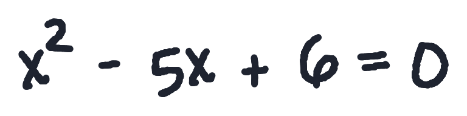 **H2b** | x^2 - 5x + 6 = 0 | x² - 5x + 6 = 0 (conf 0.95) | To solve the quadratic equation x² - 5x + 6 = 0, we can factor it:  1. Find two numbers that multiply to 6 and add to -5. These numbers are -2 and -3. 2. Rewrite the equa | ✅ 2325 tok, 4.1 s |
| 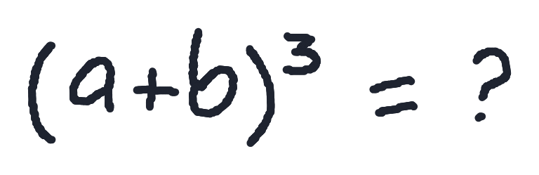 **H3a** | (a+b)^3 = ? | (a+b)^3 = ? (conf 0.98) | (a+b)³ = a³ + 3a²b + 3ab² + b³ | ✅ 2212 tok, 3.8 s |
| 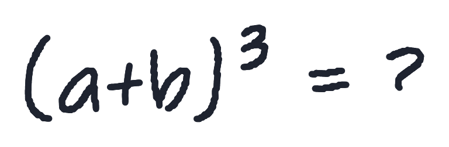 **H3b** | (a+b)^3 = ? | (a+b)^3=? (conf 0.98) | (a+b)³ = a³ + 3a²b + 3ab² + b³ | ✅ 2211 tok, 3.6 s |
|  **H4a** | lim x→0  sin x / x | lim x→0 sin x / x (conf 0.99) | The limit of sin(x)/x as x approaches 0 is 1. This is a standard limit in calculus, often used in evaluating limits involving trigonometric functions. | ✅ 2226 tok, 4.0 s |
|  **H4b** | lim x→0  sin x / x | lim x→0 sin x / x (conf 0.98) | The limit of sin(x)/x as x approaches 0 is 1. This is a fundamental limit in calculus often used in evaluating derivatives and integrals involving trigonometric functions | ✅ 2228 tok, 3.9 s |
| 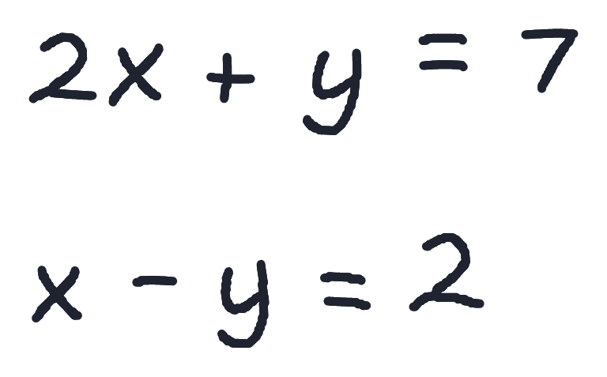 **H5a** | 2x + y = 7 / x - y = 2 | 2x + y = 7, x - y = 2 (conf 0.98) | To solve the system of equations: \n1. 2x + y = 7\n2. x - y = 2\n\nAdd the equations to eliminate y:\n(2x + y) + (x - y) = 7 + 2\n3x = 9\nx = 3\n\nSubstitute x = 3 into t | ✅ 2311 tok, 4.4 s |
| 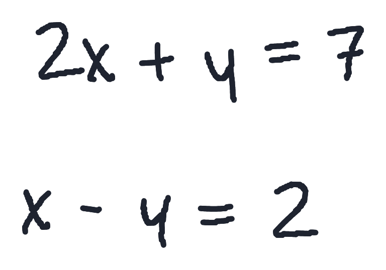 **H5b** | 2x + y = 7 / x - y = 2 | 2x + y = 7, x - y = 2 (conf 0.98) | To solve the system of equations: 1. 2x + y = 7 2. x - y = 2  Add the equations to eliminate y:  (2x + y) + (x - y) = 7 + 2 3x = 9 x = 3  Substitute x = 3 into the second | ✅ 2644 tok, 4.2 s |
| 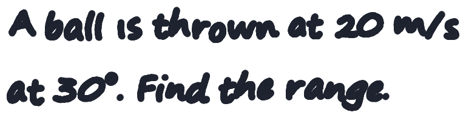 **H6a** | A ball is thrown at 20 m/s / at 30°. Find the range. | A ball is thrown at 20 m/s at 30°. Find the range. (conf 0.98) | To find the range of a projectile, use the formula: \( R = \frac{v^2 \sin(2\theta)}{g} \).  Given: - Initial velocity \( v = 20 \) m/s - Angle \( \theta = 30° \) - Accele | ✅ 2403 tok, 5.0 s |
| 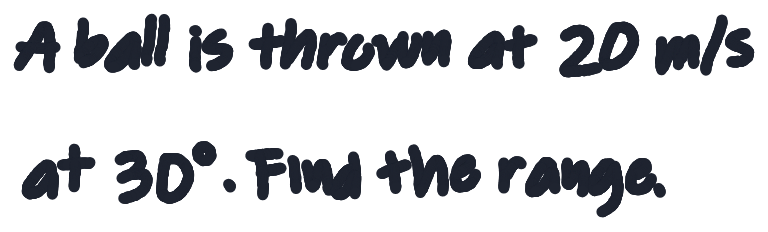 **H6b** | A ball is thrown at 20 m/s / at 30°. Find the range. | A ball is thrown at 20 m/s at 30°. Find the range. (conf 0.98) | To find the range of a projectile, use the formula: \( R = \frac{v^2 \sin(2\theta)}{g} \), where \( v \) is the initial velocity, \( \theta \) is the angle of projection, | ✅ 2467 tok, 5.4 s |
|  **H7a** | SQL: second highest / salary from Employee | SQL second highest salary from Employee (conf 0.95) | To find the second highest salary from the Employee table, you can use the following SQL query:  sql SELECT MAX(Salary) AS SecondHighestSalary FROM Employee WHERE Salary  | ✅ 2264 tok, 3.8 s |
|  **H7b** | SQL: second highest / salary from Employee | SQL: second highest salary from Employee (conf 0.98) | To find the second highest salary from the Employee table, you can use the following SQL query:  sql SELECT MAX(salary) AS SecondHighestSalary FROM Employee WHERE salary  | ✅ 2265 tok, 4.2 s |
